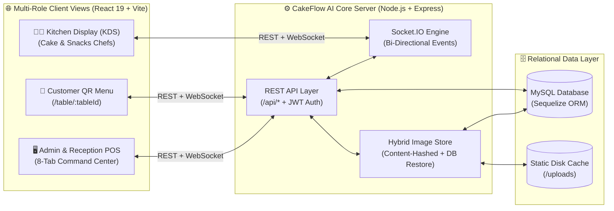
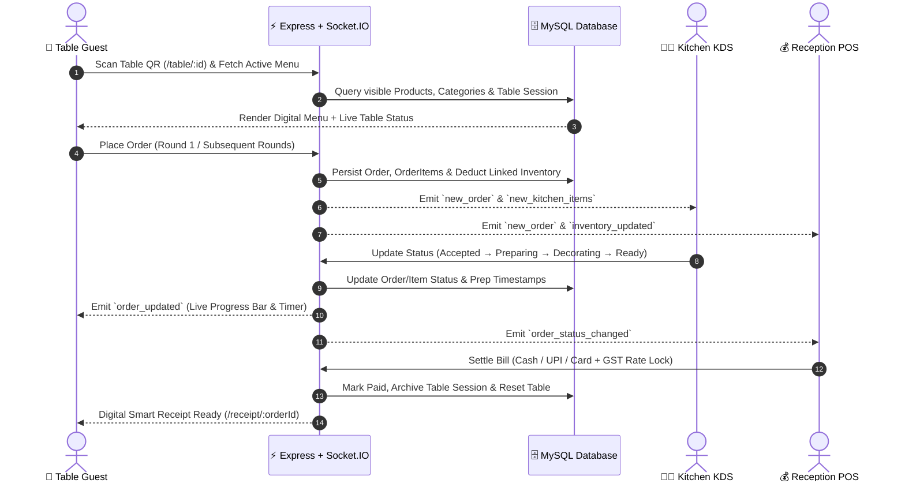
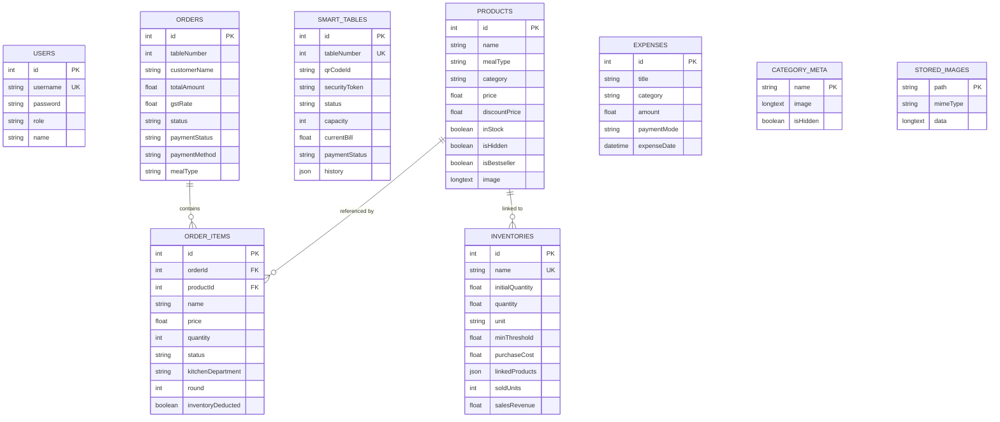

<div align="center">


# 🍰 CakeFlow AI

### **Next-Generation Smart QR Ordering, Kitchen Display & Restaurant ERP System**

*An enterprise-grade, real-time restaurant, bakery & café management platform powered by React 19, Node.js, Socket.IO, and MySQL.*

<p align="center">
  <a href="https://github.com/J-egathis/Cakeflow-Ai"></a>
  <a href="https://github.com/J-egathis/Cakeflow-Ai"></a>
  <a href="https://github.com/J-egathis/Cakeflow-Ai"></a>
  <a href="https://github.com/J-egathis/Cakeflow-Ai"></a>
  <br/>
  <a href="https://github.com/J-egathis/Cakeflow-Ai"></a>
  <a href="https://github.com/J-egathis/Cakeflow-Ai"></a>
  <a href="https://github.com/J-egathis/Cakeflow-Ai"></a>
  <a href="https://github.com/J-egathis/Cakeflow-Ai"></a>
  <a href="https://github.com/J-egathis/Cakeflow-Ai"></a>
</p>

<p align="center">
  <a href="#-executive-overview">Overview</a> •
  <a href="#-system-architecture--real-time-flow">Architecture</a> •
  <a href="#-key-platform-modules">Key Modules</a> •
  <a href="#-role-based-access-control-rbac">User Roles</a> •
  <a href="#-technology-stack">Tech Stack</a> •
  <a href="#-database-schema">Database</a> •
  <a href="#-getting-started">Quick Start</a> •
  <a href="#-api--websocket-reference">API Reference</a>
</p>

</div>

---

## 🌟 Executive Overview

**CakeFlow AI** transforms traditional bakeries, cafés, and dine-in restaurants into a synchronized, zero-latency digital ecosystem. Every dining table is equipped with a unique, cryptographically tokenized **Smart QR Code**. Guests scan the code on their smartphone to launch an instant, app-free digital menu bound directly to their table.

When an order is placed, **Socket.IO** streams it in milliseconds to specialized **Kitchen Display Systems (KDS)**—intelligently splitting items between the **Cake Studio** and **Snacks Kitchen**—while updating the **Admin Command Center**, **Reception POS Billing Desk**, and the customer's **Live Order Tracker** simultaneously.

| Pillar | What CakeFlow AI Delivers |
| :--- | :--- |
| 📱 **Frictionless QR Dining** | Zero-login table detection (`/table/:tableId`), multi-round ordering, meal-time menus (*Breakfast, Lunch, Dinner*), and live preparation countdowns. |
| 👨‍🍳 **Dual-Department KDS** | Dedicated **Cake Chef** & **Snacks Chef** queues with item-level status progression, prep timers, rejection workflows, and instant out-of-stock broadcasting. |
| 🖥️ **8-in-1 Admin & POS ERP** | Unified executive console covering AI Analytics, Reception Billing, Smart Table Floor Map, Food & Category Studio, Sold/Unsold Tracker, Inventory, and Finance/Expense Ledger. |
| 🛡️ **Self-Healing Persistence** | Pure MySQL relational engine with Sequelize ORM, automated schema migrations, GST rate locking, and content-hashed image storage backed up in MySQL (`StoredImages`). |

---

## 🏗 System Architecture & Real-Time Flow

### High-Level Architecture



### End-to-End Real-Time Order Lifecycle



---

## ✨ Key Platform Modules

### 1. 📱 Contactless Customer QR Experience (`CustomerView`)
- **Zero-App Table Binding**: Scanning a table's QR code routes directly to `/table/:tableId`, initializing a guest session bound to that table number.
- **Smart Menu Discovery**: Filter by meal period (*Breakfast, Lunch, Dinner*), custom categories, search keywords, and curated tags (**Bestseller**, **Trending**, **Chef's Recommendation**, **Special Offer** with discount pricing).
- **Multi-Round Table Ordering**: Guests can add additional rounds of items to an active table order seamlessly before final billing.
- **Real-Time Order Tracker**: Live status pipeline (`Pending` → `Accepted` → `Preparing` → `Decorating` → `Quality Check` → `Ready` → `Served`) with animated progress indicators.
- **Digital Smart Receipt**: Instant access to itemized GST invoices via `/receipt/:orderId`.

### 2. 👨‍🍳 Dual-Department Kitchen Display System (`ChefView`)
- **Department Routing**: Automatically routes bakery/cake items to the **Cake Kitchen** and savory/beverage items to the **Snacks Kitchen**.
- **Granular Stage Control**: Chefs advance individual items or full orders through `Accepted`, `Preparing`, `Decorating`, `Quality Check`, `Ready`, and `Delivered`.
- **Structured Order Rejection**: Built-in rejection workflow with standardized reasons (*Out of Stock*, *Machine Issue*, *Kitchen Busy*, *Ingredient Missing*) and custom chef notes.
- **1-Click Stock Alert Broadcast**: Chefs can toggle item stock availability directly from the kitchen screen, broadcasting `kitchen_stock_alert` and `product:updated` events to all open customer menus immediately.

### 3. 🖥️ 8-Tab Admin & Reception Command Center (`AdminView`)
Designed with an adaptive layout—full sidebar on desktop, compact icon rail on tablets, and a touch-friendly **Mobile Radial Menu** on smartphones:

1. **📊 Overview & AI Analytics**: Real-time revenue KPIs, order volume trends, peak hour detection, AI-driven demand & inventory forecasting, and filterable system-wide order logs.
2. **🧾 Reception & POS Billing Desk**: Live view of active table bills, instant bill settlement (`Cash`, `UPI`, `Card`, `Split`), historical GST rate locking per order, and thermal-ready **Smart Receipt Modal**.
3. **🪑 Smart Table Management**: Interactive floor status monitor (`Available`, `Occupied`, `Ordering`, `Preparing`, `Ready To Serve`, `Payment Pending`, `Cleaning`), guest capacity controls, and high-resolution QR code generator & downloader.
4. **🍔 Food & Category Studio**: Full CRUD for menu items and custom categories with drag-and-drop image upload, instant **Hide/Show** visibility toggles, and real-time stock synchronization.
5. **📈 Sold vs. Unsold Tracker**: Track daily prepared quantities against actual units sold, revenue realized, and unsold wastage.
6. **📦 Smart Inventory Management**: Track raw materials (`kg`, `liters`, `units`), configure minimum threshold alerts (`low_stock_alert`), link inventory items to menu products, and automate stock deductions.
7. **💼 Accounts & Finance Summary**: Consolidated financial statements combining order revenues, GST collections, inventory procurement costs, and net profit margins.
8. **💸 Daily Expense Ledger**: Record and categorize operational shop expenses (*Raw Materials*, *Utilities*, *Staff*, *Maintenance*) with payment mode tracking.

---

## 👥 Role-Based Access Control (RBAC)

CakeFlow AI enforces JWT-authenticated role guards across both API endpoints and React Router views. On first launch, the MySQL seeder automatically provisions default accounts (customizable via `.env`):

| Role | Default Username | Default Password | Primary Route | Core Responsibilities |
| :--- | :--- | :--- | :--- | :--- |
| **Store Admin** | `admin` | `admin123` | `/admin` | Full 8-tab ERP, analytics, menu, tables, inventory & finance management |
| **Head Cake Chef** | `chef` / `cake_chef` | `chef123` | `/chef` | Cake department KDS, baking/decorating status & kitchen stock alerts |
| **Snacks Chef** | `snacks_chef` | `chef123` | `/chef` | Snacks & beverage department KDS, prep timers & item readiness |
| **Floor Waiter** | `waiter` | `waiter123` | `/admin` | Table status monitoring, serving ready orders & guest assistance |
| **Front Cashier** | `cashier` | `cashier123` | `/admin` | Reception billing desk, payment settlement & smart receipt printing |
| **Table Guest** | `customer` *(or QR)* | `customer123` | `/table/:tableId` | Contactless QR menu browsing, ordering & live status tracking |

---

## 🛠 Technology Stack

### Frontend (`/client`)
| Technology | Version | Purpose |
| :--- | :--- | :--- |
| **React** | `^19.2.7` | Component-driven UI architecture |
| **TypeScript** | `~6.0.2` | End-to-end static type safety |
| **Vite** | `^8.1.1` | Lightning-fast HMR bundler & optimized production asset builds |
| **Tailwind CSS** | `^4.3.3` | Modern utility-first styling & responsive design system |
| **Framer Motion** | `^12.42.2` | Fluid micro-interactions, modal transitions & radial menu animations |
| **Recharts** | `^3.9.2` | Interactive revenue, sales & analytics data visualizations |
| **React Router DOM** | `^7.18.1` | Client-side SPA routing & protected role-based navigation |
| **Socket.IO Client** | `^4.8.3` | Real-time bi-directional event synchronization |
| **Lucide React** | `^1.25.0` | Crisp, consistent iconography |
| **QRCode** | `^1.5.4` | Client-side dynamic table QR rendering |

### Backend (`/src` & `server.js`)
| Technology | Version | Purpose |
| :--- | :--- | :--- |
| **Node.js & Express** | `^4.19.2` | High-throughput REST API server & static SPA host |
| **Socket.IO** | `^4.7.5` | Real-time pub/sub broadcasting across tables, kitchen & POS |
| **MySQL2 & Sequelize** | `^6.37.8` | Relational database driver, ORM models & automatic schema migrations |
| **JSON Web Token (JWT)** | `^9.0.2` | Stateless role-based authentication & route protection |
| **bcryptjs** | `^2.4.3` | Salted password hashing via Sequelize lifecycle hooks |
| **Multer** | `^2.3.0` | Multipart image upload processing |
| **Compression** | `^1.8.2` | Gzip response compression for fast bundle & JSON delivery |

---

## 🗄 Database Schema

CakeFlow AI uses **Sequelize ORM** with **MySQL** (`utf8mb4_unicode_ci`) and automatically creates and migrates all tables on startup:



> **💡 Self-Healing Image Storage (`src/utils/imageStore.js`)**: Uploaded product and category images are saved to `/uploads` with content-hashed filenames (`Cache-Control: max-age=31536000, immutable`) AND backed up in the `StoredImages` MySQL table. If the server is redeployed on an ephemeral filesystem, missing files are transparently restored from MySQL on first request.

---

## 📂 Project Structure

```text
CakeFlow-AI/
├── client/                          # React 19 + TypeScript + Vite Frontend
│   ├── public/
│   │   └── logo.png                 # Brand logo asset
│   ├── src/
│   │   ├── components/              # Modular UI & ERP sub-systems
│   │   │   ├── AccountsManagement.tsx
│   │   │   ├── InventoryManagement.tsx
│   │   │   ├── ManageCategoriesModal.tsx
│   │   │   ├── MobileRadialMenu.tsx
│   │   │   ├── OrderManagement.tsx
│   │   │   ├── SmartReceiptModal.tsx
│   │   │   ├── SoldUnsoldTracker.tsx
│   │   │   └── TableManagement.tsx
│   │   ├── services/
│   │   │   └── api.ts               # Axios/Fetch REST client & Socket.IO singleton
│   │   ├── views/                   # Primary role-based application views
│   │   │   ├── AdminView.tsx        # 8-Tab Admin & Reception POS Console
│   │   │   ├── BillingView.tsx      # Dedicated Billing interface
│   │   │   ├── ChefView.tsx         # Cake & Snacks Kitchen Display System (KDS)
│   │   │   ├── CustomerView.tsx     # QR Table Menu & Live Order Tracker
│   │   │   ├── LoginView.tsx        # Staff & Role Authentication Portal
│   │   │   ├── OrdersView.tsx       # Live Orders Monitor
│   │   │   └── ReceiptView.tsx      # Digital Customer Invoice (/receipt/:orderId)
│   │   ├── App.tsx                  # Route guards & QR table wrapper
│   │   ├── types.ts                 # Shared TypeScript interfaces
│   │   ├── index.css                # Tailwind v4 & custom theme styles
│   │   └── main.tsx                 # React DOM entry point
│   ├── index.html
│   ├── package.json
│   └── vite.config.ts
├── src/                             # Express + MySQL Backend
│   ├── config/
│   │   ├── jwtSecret.js             # JWT secret resolution
│   │   ├── mysql.js                 # Sequelize models, associations & auto-migrations
│   │   └── seed_mysql.js            # Automated user, menu, table & inventory seeder
│   ├── middleware/
│   │   └── auth.js                  # JWT verification & role authorization middleware
│   ├── routes/                      # Modular REST API controllers
│   │   ├── accounts.js              # Financial summaries & daily expense routes
│   │   ├── analytics.js             # KPI metrics, charts & AI forecast endpoints
│   │   ├── auth.js                  # Login & token validation routes
│   │   ├── categories.js            # Category metadata & visibility routes
│   │   ├── inventory.js             # Stock CRUD, product linking & wastage tracking
│   │   ├── orders.js                # Multi-round ordering, KDS status & billing
│   │   ├── products.js              # Menu CRUD, stock toggles & image uploads
│   │   ├── system.js                # System settings (GST rate, store config)
│   │   └── tables.js                # Smart table state, QR regeneration & history
│   ├── sockets/
│   │   └── index.js                 # Socket.IO room management & global broadcasters
│   └── utils/
│       └── imageStore.js            # Content-hashed disk storage + MySQL binary backup
├── datas/                           # Default JSON seed metadata
│   ├── categories.json
│   └── settings.json
├── uploads/                         # Static uploaded images (auto-restored from DB)
├── server.js                        # Unified Express + Socket.IO entry point
├── package.json                     # Root scripts & backend dependencies
└── vercel.json                      # Deployment routing configuration
```

---

## 🚀 Getting Started

### Prerequisites
- **Node.js** `v18.0+` (recommended `v20+`)
- **MySQL Server** `v8.0+` running locally or remotely
- **npm** `v9+`

### 1. Clone the Repository
```bash
git clone https://github.com/J-egathis/Cakeflow-Ai.git
cd Cakeflow-Ai
```

### 2. Configure Environment Variables
Create a `.env` file in the root directory:

```env
# Server Configuration
PORT=5001
NODE_ENV=development

# MySQL Database Credentials
MYSQL_HOST=localhost
MYSQL_PORT=3306
MYSQL_USER=root
MYSQL_PASSWORD=your_mysql_password
MYSQL_DATABASE=cakeflow

# Authentication Security
JWT_SECRET=your_super_secret_jwt_key_here

# Optional: Override Default Role Passwords
ADMIN_PASSWORD=admin123
CHEF_PASSWORD=chef123
WAITER_PASSWORD=waiter123
CASHIER_PASSWORD=cashier123
CUSTOMER_PASSWORD=customer123
```

> **Note:** You do **not** need to manually run any SQL scripts. On startup, `CakeFlow AI` automatically creates the `cakeflow` database, syncs all 9 tables, runs schema migrations, and seeds initial demo users, categories, products, tables, and inventory.

### 3. Install Dependencies
Installing at the root automatically installs both backend and frontend (`/client`) dependencies via `postinstall`:

```bash
npm install
```

### 4. Run in Development Mode
Launch both the **Express + Socket.IO Backend** (`http://localhost:5001`) and **Vite React Frontend** (`http://localhost:5173`) concurrently:

```bash
npm run dev-all
```

Or run them separately:
```bash
# Terminal 1: Backend Server
npm run dev

# Terminal 2: Frontend Vite Dev Server
npm run client-dev
```

### 5. Build & Run for Production
Compile the TypeScript + Vite frontend into `client/dist` and serve the entire unified application from the Express server on a single port:

```bash
npm run build
npm start
```

---

## 🔌 API & WebSocket Reference

### Core REST API Endpoints
| Base Route | Key Operations |
| :--- | :--- |
| `POST /api/auth/login` | Authenticate staff/guest credentials and issue signed JWT |
| `GET / POST / PUT / DELETE /api/products` | Menu item CRUD, visibility toggles, stock updates & image uploads |
| `GET / POST / PUT / DELETE /api/categories` | Category management, custom category images & hide/show toggles |
| `GET / POST / PUT /api/orders` | Create/append table orders, update KDS item statuses & settle bills |
| `GET / POST / PUT / DELETE /api/tables` | Smart table management, QR code generation & table reset |
| `GET / POST / PUT / DELETE /api/inventory` | Raw material tracking, product linking & sold/unsold wastage logs |
| `GET / POST / DELETE /api/accounts` | Financial P&L metrics & daily shop expense ledger |
| `GET /api/analytics` | Real-time dashboard KPIs, revenue charts & AI demand forecasts |
| `GET / PUT /api/system` | Global store configurations & dynamic GST percentage settings |

### Real-Time Socket.IO Events
| Event Name | Direction | Description |
| :--- | :--- | :--- |
| `new_order` / `new_kitchen_items` | Server → Clients | Broadcasts newly placed or appended table orders to KDS & POS |
| `order_updated` / `order_status_changed` | Server → Clients | Syncs chef stage changes and billing settlements across all views |
| `kitchen_stock_alert` / `product:updated` | Bi-Directional | Instant out-of-stock or menu visibility update across active guest menus |
| `inventory_updated` | Server → Clients | Real-time inventory level sync after order deductions or restocks |
| `low_stock_alert` | Server → Clients | Triggered automatically when an ingredient drops below `minThreshold` |

---

## 🤝 Contributing

Contributions, issues, and feature requests are welcome!

1. **Fork** the repository (`https://github.com/J-egathis/Cakeflow-Ai/fork`)
2. **Create** your feature branch (`git checkout -b feature/AmazingFeature`)
3. **Commit** your changes (`git commit -m 'feat: Add AmazingFeature'`)
4. **Push** to the branch (`git push origin feature/AmazingFeature`)
5. **Open** a Pull Request

---

## 📄 License

Distributed under the **MIT License**. See `LICENSE` for more information.

---

<div align="center">

### 👨‍💻 Designed & Engineered by **Jegathis**

**Full-Stack Developer & UI/UX Architect**

[](https://github.com/J-egathis)

<br/>

⭐ **If you found CakeFlow AI helpful or inspiring, please consider giving this repository a Star!** ⭐

</div>
